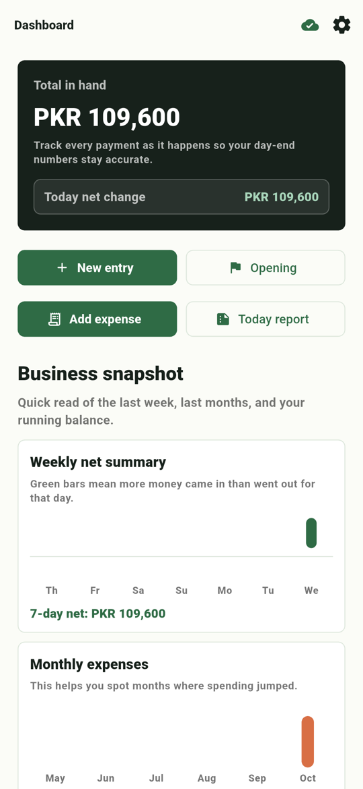
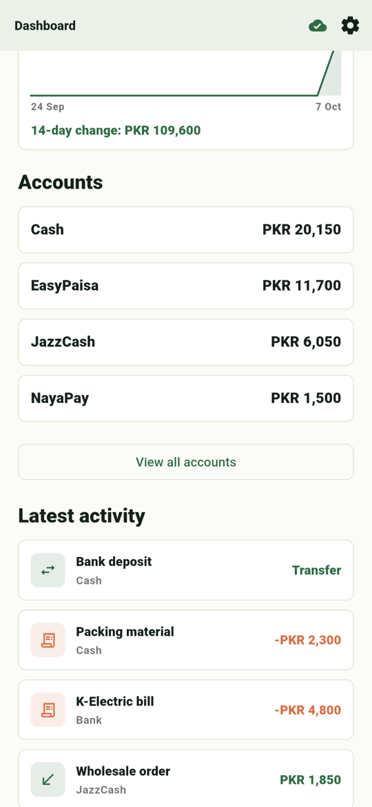
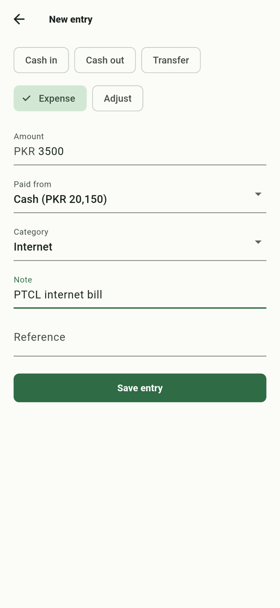
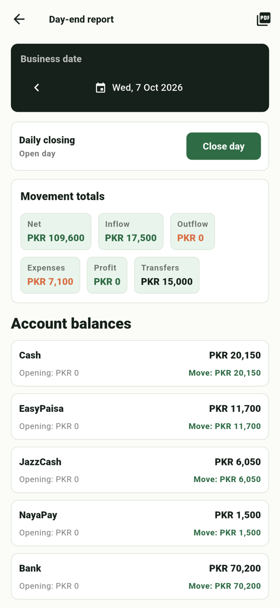
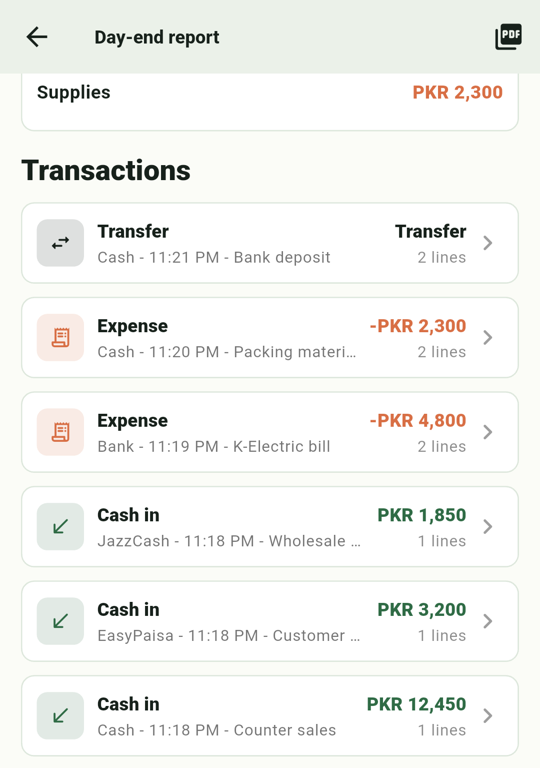

# Dukaan Book

    

An offline-first money ledger for small shopkeepers in Pakistan. A typical shop holds money in a cash drawer, EasyPaisa, JazzCash, NayaPay and a bank account at the same time; Dukaan Book tracks every rupee across all of them and produces a day-end closing report, even when the internet is down.

## Screenshots

| Dashboard | Accounts | New expense | Day-end report | Transactions |
|:---:|:---:|:---:|:---:|:---:|
|  |  |  |  |  |

## Features

- Accounts for Cash, EasyPaisa, JazzCash, NayaPay, Bank and Owner Equity
- Ledger entries: cash in, cash out, transfers between accounts, expenses and adjustments
- Expense categories and daily expense tracking
- Dashboard with live balances, today's net change and recent activity
- Day-end report with totals, closing balances, expense breakdown and drill-down to each transaction
- Report export to PDF and sharing through the Android share sheet
- Daily closing reminder notification
- Shop onboarding, plus shop members who can join an existing shop
- Works fully offline; changes sync to Supabase when a connection is available

## Engineering highlights

- **Offline-first sync:** every write goes to a local Drift database and an outbox table. A sync service pushes the outbox and pulls remote changes when connectivity returns. Supabase has no built-in offline sync, so this is custom.
- **Money as integers:** amounts are stored in paisa to avoid floating-point errors.
- **Business dates:** reports use the `Asia/Karachi` business day regardless of device time zone.
- **Row-level security:** Supabase tables are scoped to shop membership through an `is_shop_member()` policy helper and a `join_shop` RPC.

## Tech stack

| Area | Technology |
|---|---|
| App | Flutter 3, Material 3 |
| State and routing | Riverpod 3, GoRouter |
| Local database | Drift (SQLite) |
| Backend | Supabase (Auth, Postgres, RLS, RPC) |
| Reports | pdf, printing, share_plus |
| Notifications | flutter_local_notifications, timezone |

## Project structure

```
lib/
├── app/        bootstrap, router, theme
├── core/       config, local database, money, time, Supabase client
└── features/   accounts, auth, dashboard, ledger, onboarding, reports, settings, sync, notifications
supabase/
└── migrations/ schema, RLS policies, shop members, join_shop RPC
docs/           architecture, database schema, Supabase setup
```

## Getting started

**Requirements:** Flutter 3.41+ (stable) and an Android device or emulator. A Supabase project is only needed for sign-in and sync; the app boots without one in development.

```bash
flutter pub get
cp .env.example .env          # SUPABASE_URL and SUPABASE_ANON_KEY
flutter run --dart-define-from-file=.env
```

Apply the database schema to your Supabase project with the files in `supabase/migrations` (see [docs/SUPABASE_SETUP.md](docs/SUPABASE_SETUP.md)).

### Release build

```bash
flutter build apk --release --dart-define-from-file=.env
```

On Windows, `.\tool\build_apk.ps1` does the same and fails early if the Supabase values are missing. The `.env` file is never bundled into the app.

## Testing

```bash
flutter analyze
flutter test
```

## Documentation

- [Architecture](docs/ARCHITECTURE.md)
- [Database schema](docs/DATABASE_SCHEMA.md)
- [Supabase setup](docs/SUPABASE_SETUP.md)

_Developed April 2026. Imported from a private repository; the commit history was left out because it contained credentials._

## License

MIT. See [LICENSE](LICENSE).
